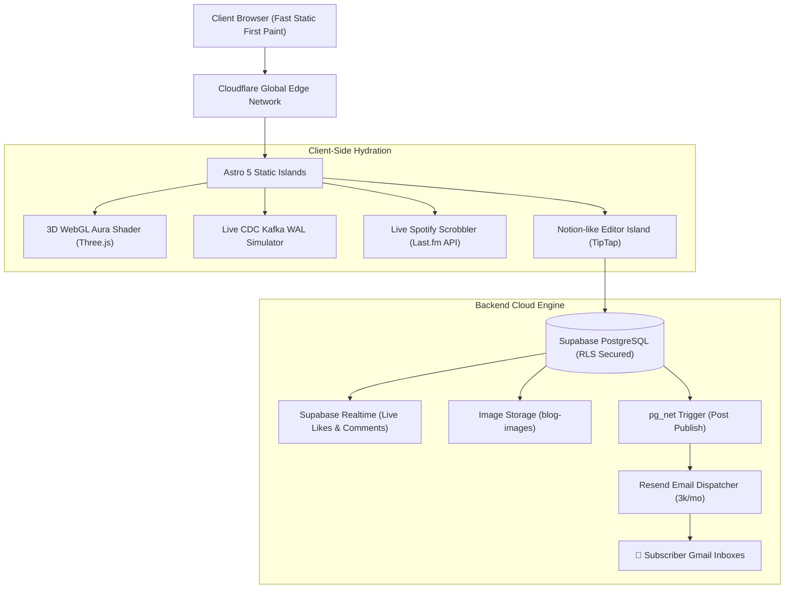

<div align="center">

# ⚡ Divyanshu Kumar — Senior Engineering Portfolio & Living Blog

*Distributed Systems · Data Streaming & CDC Pipelines · High-Performance Web Architecture*

[](https://astro.build)
[](https://react.dev)
[](https://www.typescriptlang.org/)
[](https://threejs.org/)
[](https://supabase.com)
[](https://resend.com)
[](https://pages.cloudflare.com)

[Live Demo](https://divyanshunyk.dev) · [Selected Work](/work) · [Tech Stack](/stack) · [Living Blog](/blog) · [Contact](/contact)

</div>

---

## 🏛️ System Architecture & Highlights

A production-grade, state-of-the-art developer portfolio and living publication engine architected with zero-runtime client bloat, edge delivery, and real-time backend synchronization.



---

## ✨ Flagship Engineering Features

### 1. ✍️ Notion-Grade Living Blog & Publication Engine
* **TipTap Rich Text Editor:** Slash command menu (`/`), rich formatting (headings, blockquotes, code blocks with syntax highlighting, task lists, links, images).
* **Supabase Realtime Synchronization:** Instant live comment streams and optimistic UI likes without page reloads.
* **Anonymous Fingerprint Liking:** SHA-256 client fingerprinting allows users to like/unlike posts seamlessly without requiring authentication.
* **Photo Albums & Lightbox:** Multi-image gallery attachments per post with modal lightbox viewer.
* **Email Newsletter Dispatcher:** Automated SQL trigger via `pg_net` and **Resend API** blasts branded newsletter notifications to all active subscribers upon publishing.

### 2. 🎵 Live Spotify & Last.fm Music Scrobbler with Revolving Vinyl
* Real-time polling of Spotify listening activity via Last.fm API.
* **Revolving Vinyl Disc:** A miniature 3D-styled vinyl record with sound grooves and a circular sticker displaying the **real album artwork** of the current song.
* Automatically spins when music is playing and pauses smoothly when inactive, paired with dancing soundwave equalizer bars.

### 3. 🖥️ Interactive Change Data Capture (CDC) Terminal
* An authentic ANSI-colored terminal simulator streaming synthetic PostgreSQL WAL changes, Debezium CDC records, and Kafka events.
* Full command interface (`help`, `clear`, `lsn`, `metrics`, `whoami`, `benchmark`) with interactive execution.

### 4. 🎨 Three.js Kinetic Aura & Multi-Theme Architecture
* Interactive 3D WebGL fluid background shader reacting to cursor and touch inertia.
* **Zero-Flash Theme Engine:** 3 distinct handcrafted palettes (`Dawn`, `Daylight`, `After-Hours`) with pre-paint theme resolution and cross-tab synchronization.
* Fluid typography powered by CSS clamp functions, scaling seamlessly from 320px mobile screens to 4K displays.

### 5. 🕹️ Easter Eggs & Companion Systems
* **Playable Chrome Dino:** Embedded inside the interactive `DK` emblem modal with physics, high scores, and audio feedback.
* **Oneko Companion:** Interactive pixel-art cat companion that snoozes on dividers and chases your cursor/finger across the screen.

---

## 📂 Monorepo Architecture

```
portfolio-divyanshuNYK/
├── apps/
│   └── web/                        # Astro 5 front-facing application
│       ├── src/
│       │   ├── components/         # Modular Astro & React components
│       │   │   ├── blog/           # TipTap editor, post viewer, subscriber box
│       │   │   ├── canvas/         # Three.js 3D background shader
│       │   │   ├── hero/           # Interactive profile & CDC console
│       │   │   ├── nav/            # Floating glass nav dock & Command Palette
│       │   │   └── ui/             # Oneko cat, Dino modal, easter eggs
│       │   ├── layouts/            # BaseLayout with zero-flash theme engine
│       │   ├── lib/                # Supabase client, SQL schemas, types
│       │   ├── pages/              # Astro file-based routes (/, /work, /stack, /blog, /admin)
│       │   └── styles/             # Global tokens, typography, blog styles
│       ├── .env.example            # Environment template
│       └── astro.config.mjs        # Static output build configuration
├── packages/
│   └── tokens/                     # Shared design token design system
│       └── src/tokens.css          # Semantic CSS tokens for Dawn/Daylight/After-Hours
├── wrangler.jsonc                  # Cloudflare Pages deployment configuration
└── package.json                    # Workspace scripts & dependencies
```

---

## 🛠️ Tech Stack & Dependencies

| Layer | Technologies |
|---|---|
| **Core Framework** | [Astro 5](https://astro.build) (Static output, Client Islands) |
| **Component UI** | [React 19](https://react.dev), [Vanilla CSS](https://developer.mozilla.org/en-US/docs/Web/CSS) (Tailwind v4 tokens) |
| **3D & Shaders** | [Three.js](https://threejs.org), Custom GLSL Shaders |
| **Editor** | [TipTap Core](https://tiptap.dev) (StarterKit, Image, TaskList, Typography, Lowlight) |
| **Database & Auth** | [Supabase](https://supabase.com) (PostgreSQL, Row Level Security, Realtime, Storage) |
| **Email Engine** | [Resend](https://resend.com) + `pg_net` PostgreSQL trigger |
| **Live Music** | [Last.fm AudioScrobbler API](https://www.last.fm/api) + Spotify Scrobbling |
| **Hosting & CDN** | [Cloudflare Pages](https://pages.cloudflare.com) / [Vercel](https://vercel.com) |

---

## 🚀 Local Development Setup

### Prerequisites
* **Node.js** >= 20.0.0
* **pnpm** >= 9.0.0

### 1. Clone & Install
```bash
git clone https://github.com/d1vyanshu-kumar/portfolio-divyanshunyk.git
cd portfolio-divyanshunyk
pnpm install
```

### 2. Configure Environment Variables
Create `apps/web/.env`:
```env
PUBLIC_SUPABASE_URL=https://your-project.supabase.co
PUBLIC_SUPABASE_ANON_KEY=your-supabase-publishable-key
RESEND_API_KEY=re_your_resend_api_key
```

### 3. Run Development Server
```bash
pnpm --filter @portfolio/web dev
# Access local server at http://localhost:4321
```

### 4. Build for Production
```bash
pnpm --filter @portfolio/web build
# Static bundle outputs to apps/web/dist/
```

---

## 🔒 Security & Privacy Architecture
* **Row Level Security (RLS):** All Supabase tables (`posts`, `comments`, `likes`, `subscribers`) are protected by explicit RLS policies.
* **Admin Verification:** Admin privileges for creating, editing, and deleting posts require authenticated magic link sessions.
* **Visitor Privacy:** Zero third-party trackers, zero advertising scripts, and anonymous likes use local SHA-256 device hashing without persisting personal identifiers.

---

## 👤 Author

**Divyanshu Kumar**  
*Software Engineer · Distributed Systems & Infrastructure*  
*GSoC '26 @debezium · GSoC '25 @MIT App Inventor*  

* **Website:** [divyanshunyk.dev](https://divyanshunyk.dev)
* **GitHub:** [@d1vyanshu-kumar](https://github.com/d1vyanshu-kumar)
* **LinkedIn:** [Divyanshu Kumar](https://linkedin.com/in/divyanshu-kumar-24026b296)
* **Twitter / X:** [@NykDivyanshu](https://x.com/NykDivyanshu)
* **Dev.to:** [@d1vyanshukumar](https://dev.to/d1vyanshukumar)

---

<div align="center">
  <sub>Architected with precision &middot; Built with modern web standards &middot; &copy; 2026 Divyanshu Kumar</sub>
</div>
